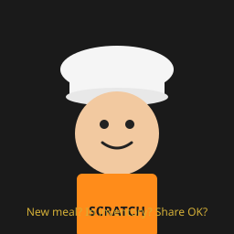
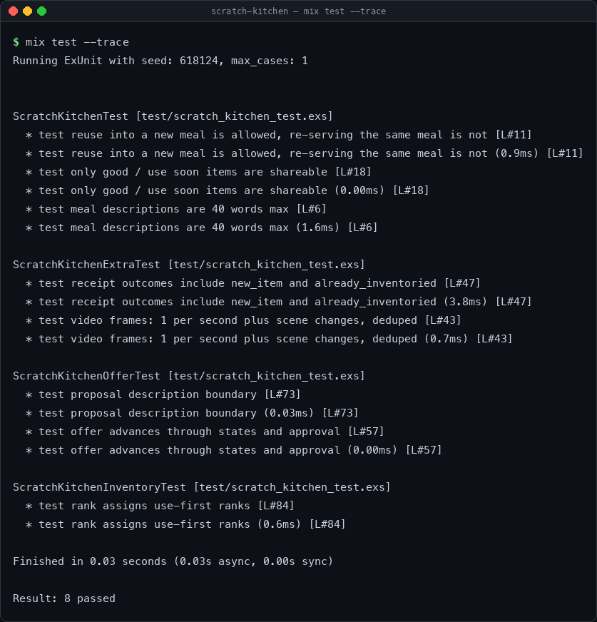
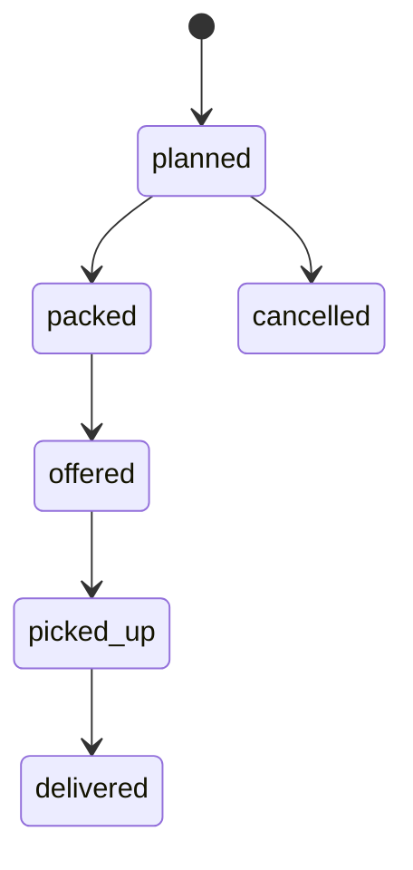
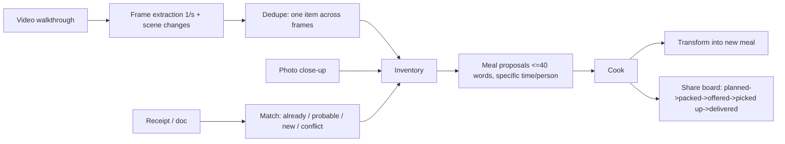

# Scratch Kitchen

[](LICENSE)
[](mix.exs)
[](ios/)
[](SECURITY.md)
[](https://github.com/hamanakam1/scratch-kitchen/releases)



**Scratch cooking, from what you already have — reused into new meals, never re-served as leftovers, with the extra shared instead of wasted.**

Scratch Kitchen is a photo-first kitchen app. Photograph everything coming into the kitchen, get an initial inventory, and get specific meals proposed for specific people at specific times, based only on ingredients actually on hand. Prepared food that will not be eaten at home is planned for sharing — giveaway first, cottage-kitchen sale only after a compliance check is recorded.



Open source, MIT licensed. Local-first by design. No kitchen photo is sent to a cloud service for recognition without an explicit approval.

> Status: MVP scaffold, October 31, 2026. The Elixir coordination core and the SwiftUI camera face are sketched as working structure, not yet a compiled, shippable app. See [Roadmap](#roadmap).

---

## The problem, in one paragraph

A scratch cook reuses things. A household that does not like leftovers will not eat yesterday's meal again. Those two facts collide in every fridge. Scratch Kitchen resolves them by enforcing a distinction most meal apps ignore:

- **An ingredient may be reused.**
- **A served meal may not be re-served as the same meal.**

Roasted chicken becomes chicken soup. It does not become "leftover chicken." Extra prepared food that will not be eaten at home does not sit in the fridge until it goes off — it becomes a planned, labelled, approved share.

## How it works

### 1. Video in first — photos still an option

**Video is the primary way in. Photos are an option, not the workflow.**

Taking pictures item by item is way too slow. The fast way: make a video, and Scratch Kitchen understands what you have on hand from that video. Photos stay available for the cases where they help — a close-up of a label, a single new grocery item, or anything the video could not identify clearly — but nobody has to photograph the whole kitchen one item at a time.

How video inventory works:
- You record one continuous video per location (freezer, fridge, pantry), slow pan, no fast cuts, labels facing the camera where possible. One 30–60 second walkthrough beats 30 photos.
- The app extracts frames at regular intervals (e.g. 1 frame per second, plus a frame whenever the scene changes), and identifies items from those frames — on-device first, no cloud upload without approval.
- The same item seen in multiple frames is counted **once**, not once per frame. Items are tracked across frames by location + appearance, and a later frame only updates quantity / still-good judgement, it does not create a duplicate.
- Each inventoried item keeps its source: video file, timestamp in the video (e.g. `freezer_walkthrough.mp4 @ 00:23`), and the best frame for that item. If an item is unclear, it is flagged for a still photo, not guessed.
- A video batch is inventoried like a photo batch: same fields, same use-first ranking, same history.

Photos, as an option:
- A still photo of one item, one label, or one new grocery bag coming in.
- A close-up to resolve a flagged video item.
- Same naming as video items, same inventory fields — photos and video feed the same inventory, they are not two separate systems.

See `docs/video-inventory.md` for recording tips and the frame rules.

### Receipts and documents — smart, no duplicates

Photograph a receipt — or a shopping list, delivery confirmation, pantry list, or label — and the system must be smart enough to know if that receipt's items were already inventoried from a video or photo.

Every receipt line gets one outcome, shown, never silent:
- `already_inventoried` — already in inventory, no duplicate created
- `probable_match` — likely the same item, wording differs, shown for confirmation, not auto-merged
- `new_item` — genuinely new, added with the receipt as source
- `conflict` — receipt quantity vs video quantity disagree, or receipt date is after the item was used — flagged, not guessed

A receipt never overrides a later video, and never creates a meal or share on its own. Price is recorded, but price alone never creates an inventory item. See `docs/receipt-inventory.md`.

Photo naming: `<YYYY-MM-DD>_<location>_<section>.jpg`
Example: `2026-11-01_freezer_top-shelf.jpg`

Each photo is inventoried, not just stored:

| Field | Meaning |
|---|---|
| Item | What it is, as identified from the photo |
| Photo file + date | Which photo it came from, and when |
| Location | Freezer / fridge / pantry / prepared |
| Quantity estimate | How much, roughly — never invented precisely |
| Bought / opened date | If known, otherwise blank |
| Still-good judgement | `good` / `use soon` / `check` / `do not use` — the cook's judgement, not a food-safety guarantee |
| Use-first rank | 1 = use first |

Items that cannot be identified from a photo are flagged, not guessed.

### 2. Initial inventory

First run: photograph freezer, then fridge, then pantry, in that order. That builds the baseline inventory.

**No meal is proposed from an item that is not in inventory.** If it is not photographed and inventoried, it is not in a meal.

### 3. Propose meals, specific

For each meal slot, the app proposes, every time:

- **Meal:** a specific meal — small, simple, Marin-style, description ≤ 40 words
- **Ready:** a specific day and time
- **For:** a specific person — the principal, or a named household member
- **Uses:** specific inventory items, rank 1–3 first, with quantities
- **Uses up:** which rank-1 item this meal fully or partly finishes
- **Leftover check:** what, if anything, remains, and what it becomes next — or "none, shared"

Example proposal:

> **Meal:** Herb chicken soup, small bowl, crusty bread.
> **Ready:** Saturday, 6:15pm
> **For:** Jason
> **Uses:** roasted chicken (from Thursday), carrots, celery, stock
> **Uses up:** roasted chicken, fully
> **Leftover check:** none — soup is a new meal, not re-served chicken

#### Meal proposal rules

Best option order, every time:

1. Uses a whole rank-1 item, no new shopping.
2. Two rank-1/2 items together.
3. Rank-1 item + pantry staple already in inventory.
4. Only then, a meal needing one small named bought item — and that item goes on a shopping list, it is not assumed in stock.

Other rules:

- Portions are small and simple, variety over elaborate plating or oversized portions.
- No meal that depends on household members eating leftovers as leftovers, unless the cook says so for that specific meal.
- Reuse must be named as a transformation: roasted chicken → chicken soup, not "leftover chicken."
- If a meal cannot be ready at the requested time with the ingredients and prep available, it is proposed for the next feasible slot, not for an impossible one.
- Proposals are per person. A person who eats very little gets a separate portion and timing, not a scaled-down copy of someone else's meal.
- Only preferences actually stated for a person are used. No preference, allergy, or dietary rule is invented for anyone.

### 4. Cook, eat, reuse, share

After a meal, inventory updates: items used are removed or reduced, and any remaining prepared food is either:

- **(a) Transformed** into a new meal's ingredient, with the transformation named, or
- **(b) Flagged for share** (see below).

### 5. Share extra food

Prepared food that is still good but will not be eaten at home is prepared, packed, labelled, and offered for local delivery or coordination — not left in the fridge.

Two tracks, kept strictly separate:

#### Giveaway share

Food still good but not eaten at home, prepared and given to people in need, free.

Candidate criteria — **all** must be true:

- Labelled `good` or `use soon` only (never `check` / `do not use`)
- Not expected to be eaten at home before it goes off
- Prepared and packed safely
- The cook approves that specific batch, item, quantity, and date

Handling: separate preparation, clean labelled containers (what, date prepared, allergens if known), hot/cold control, no extended room-temperature holding, no reheated-multiple-times or unclear-opened-date items. Doubt = exclude.

#### Cottage kitchen sale

Food prepared for sale under a cottage food operation. Separate labelling, pricing, and compliance — never relabelled giveaway food, and never relabelled sold food as giveaway.

**Compliance flag, not legal advice:** cottage food rules, food-handler requirements, labelling, and permitted foods vary by state and county, and by sale vs. giveaway. Before any sale, confirm the current California / Marin County cottage food requirements, permitted foods list, and labelling rules from an official source, and record that check in the app's compliance log. See `docs/cottage-compliance.md`.

#### Delivery / coordination in v1

A simple share board:

```
planned → packed → offered → picked up → delivered
```

Giveaway vs. cottage sale is clearly labelled on every offer. A named human coordinator completes pickup and delivery. **No automatic dispatch, no payment, no courier booking in v1.** The app prepares an offer, the cook approves it, a human completes it. The app does not arrange a driver, take payment, book a courier, contact recipients, or claim a food is safe.




## Architecture



Two faces, one core:

```
┌─────────────────────────┐      ┌──────────────────────────────┐
│  SwiftUI (iPhone / Mac) │      │  Elixir / BEAM (coordination) │
│  Camera face            │◄────►│  Inventory, meals, share board │
│  Photos, on-device      │      │  Timers, offers, history        │
│  Vision, Live Activity  │      │  Supervision trees              │
└─────────────────────────┘      └──────────────────────────────┘
```

- **SwiftUI** is the camera face: photographing, on-device Vision recognition, meal cards, lock-screen "ready at" times. No cloud round-trip for recognition without approval.
- **Elixir / BEAM** is the coordination heart: inventory ranking, meal proposals, share-board state, timers. Built for many things happening at once, where one failing process (a timer, an offer) must not take down the rest. See `docs/architecture.md`.

Alternative cores, for contributors: a Rust core for the deterministic meal engine, or a Nim prototype for a fast local-first iteration. The SwiftUI face stays the same.

## Repository layout

```
scratch-kitchen/
├── README.md                    # this file
├── LICENSE                      # MIT
├── CONTRIBUTING.md
├── SECURITY.md
├── mix.exs                      # Elixir project (coordination core)
├── lib/
│   └── scratch_kitchen/
│       ├── inventory/
│       │   ├── item.ex          # Item struct + still-good judgements
│       │   └── inventory.ex     # Use-first ranking, photo batches
│       ├── meals/
│       │   ├── proposal.ex      # Meal proposal struct + rules
│       │   └── reuse.ex         # Ingredient reuse transformations
│       └── share/
│           ├── offer.ex         # Share offer, giveaway vs cottage sale
│           └── board.ex         # Share board state machine
├── ios/
│   └── ContentView.swift        # SwiftUI sketch: photo in, meals, share board
├── test/
│   └── scratch_kitchen_test.exs # Core rule tests (sketch)
└── docs/
    ├── architecture.md
    ├── kitchen-inventory.md
    ├── share-board.md
    ├── cottage-compliance.md
    └── spec.md                  # Full app spec, v1
```

## Getting started (scaffold)

This is a scaffold, not yet a compiled app. Elixir and Swift are not installed in the build environment used for this scaffold, so the code below has not been compiled here — it is structure and rules, ready for a Mac with Xcode and Elixir installed.

### Elixir core (when Elixir is installed)

```bash
cd scratch-kitchen
mix deps.get
mix test
mix run --no-halt   # starts the coordination core (see lib/)
```

### SwiftUI face (on a Mac, with Xcode)

1. Open `ios/` as a SwiftUI project.
2. Build for iPhone (camera) and Mac (kitchen dashboard).
3. On-device Vision recognition first — no cloud photo upload without approval.

### First real run

1. Photograph the freezer, top shelf to bottom.
2. Photograph the fridge, remaining items.
3. Photograph the pantry.
4. Send those photos through the inventory step — the app inventories them, ranks use-first, and proposes the first day's specific meals from inventory only.
5. Approve a meal, cook it, update inventory, and flag any extra for share.

## Data model, in brief

- **Item:** id, name, photo file + date, location, quantity estimate, unit, bought/opened date (if known), still-good judgement, use-first rank, notes.
- **Photo batch:** date, location, section, photo files, items extracted, items that could not be identified (flagged).
- **Meal:** id, name, description (≤ 40 words), ready time, for person, ingredients (item ids + quantities), uses-up list, leftover / transform / share outcome.
- **Share batch:** id, meal id, items, quantity, date prepared, label (what, date prepared, allergens if known), status (planned / packed / offered / picked up / delivered / cancelled), track (giveaway / cottage sale), recipient route (only as approved).

No item, meal, or share is deleted from history. Corrections are new versions. Inventory history is the audit trail for what was actually used, shared, or wasted.

## What this app is not

- Not a restaurant ordering app, not a delivery app, not a food-safety certification.
- It does not invent inventory, preferences, allergies, or recipients.
- It does not serve leftovers as leftovers to people who do not like leftovers. It transforms ingredients into new meals, and shares extra prepared food through a planned, approved share.
- It does not send, sell, or deliver anything without the cook's specific approval for that specific meal, batch, or offer.

## Roadmap

- [x] Spec v1, kitchen inventory template, share-board rules
- [x] MVP scaffold: Elixir core structure, SwiftUI face sketch, extensive README
- [x] OpenCode improvement pass: `mix test` 3/3, video + receipt fleshed out (2026-11-01)
- [x] GitHub repo created (public, `main`): https://github.com/hamanakam1/scratch-kitchen — 2026-11-01
- [x] Elixir core compile + `mix test` — 3/3 passing (2026-11-01, Elixir 1.20.5)
- [ ] SwiftUI capture UI — blocked: Xcode not installed (only CommandLineTools)
- [ ] Compile and test the Elixir core on a machine with Elixir installed
- [ ] SwiftUI app: photo capture, on-device Vision inventory, meal cards, Live Activities
- [ ] One-day meal proposal, proven with a real frozen-foods batch
- [ ] Inventory update after cooking + reuse transformation naming
- [ ] Share board, giveaway only, per-batch approval
- [ ] Cottage sale track, only after the compliance check in `docs/cottage-compliance.md` is recorded
- [ ] Delivery coordination with a named human coordinator
- [ ] Learning loop: what was actually eaten, shared, or wasted feeds next week's proposals — ever-improving, full packet each week, not just a delta

## Contributing

See `CONTRIBUTING.md`. Short version: small, simple, local-first, no invented data, no silent edits, every rule change as a new version, every share as an approved batch.

## License

MIT. See `LICENSE`. Scratch Kitchen is open source — use it, fork it, improve it, and share the extra.

## Acknowledgements

Built from a real kitchen: a scratch cook, a household that does not like leftovers, and a freezer that needed photographing first.

## Known blockers

- Elixir 1.20.5 installed via Homebrew; builds and tests pass.
- Xcode 27.2 available; `swiftc -parse` on `ios/ContentView.swift` passed (2026-11-01).
