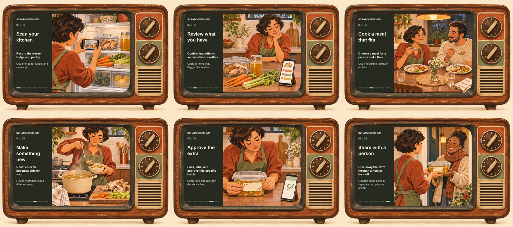

# Scratch Kitchen storyboard

The [repository overview](../README.md) tells the product story through one animated GIF inside an illustrated 1970s wooden television. These are concept illustrations of the intended experience, not application screenshots or evidence that camera recognition and sharing are released.



## The six scenes

| Scene | What happens | Product rule |
| --- | --- | --- |
| 1. Scan your kitchen | The cook records the food already in the refrigerator. | Walk through freezer, fridge and pantry; use photos for labels and close-ups. |
| 2. Review what you have | The cook reviews ingredients beside a phone inventory. | Confirm what is present, prioritize use-first items, and flag uncertainty. |
| 3. Cook a meal that fits | Two people enjoy a modest meal of chicken and vegetables. | Plan for a specific person and time, using ingredients actually on hand. |
| 4. Make something new | The remaining roast chicken becomes chicken-and-vegetable soup. | Reuse ingredients in a new meal instead of repeating the same dinner. |
| 5. Approve the extra | The cook labels a closed container and confirms the batch. | Keep food and allergen details visible; require approval for that specific batch. |
| 6. Share with a person | The cook hands the labeled food directly to a neighbor. | Giveaway first, with a human coordinator. Cottage sales remain separate and need a recorded compliance check. |

The story follows the existing [specification](spec.md), [video inventory guide](video-inventory.md), and [share-board rules](share-board.md). It does not depict automatic dispatch, payment, courier booking, or food-safety certification.

## Assets and rebuilding

- [Animated television](storyboard/scratch-kitchen-tv.gif): 1100 × 733 pixels, a 27-second continuous loop. Each scene holds for 4.5 seconds with a slight three-position camera move. No flashing or simulated static.
- [Static six-scene storyboard](storyboard/scratch-kitchen-storyboard.png): the full story without motion, linked directly below the overview animation.
- [First-scene poster](storyboard/scratch-kitchen-tv-poster.png): a still fallback.
- [Build metadata](storyboard/build.json): actual GIF dimensions, frame count, duration, and size.
- [Illustration prompts](storyboard/source/prompts.json): the exact prompt set used with the built-in image_gen tool. The generated television and scene sheet are retained as WebP source assets alongside it.

The generated illustrations were assembled and captioned with Pillow; text is rendered by the build script rather than generated inside the artwork. The cabinet stays fixed throughout the animation. All example food, people, and interface content are illustrative.

With Python 3 and Pillow installed:

```bash
python3 scripts/build_storyboard.py
```

The default fonts are macOS Arial. On another system, point `STORYBOARD_FONT` and `STORYBOARD_BOLD_FONT` at compatible regular and bold TrueType fonts. Source illustrations are already included; rebuilding does not call an image-generation service.
